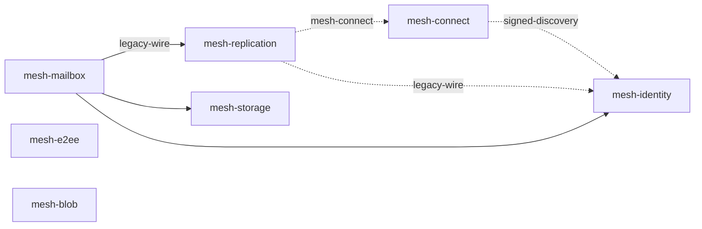

# Composing Mesh Foundation

## Choose the smallest useful set of crates

The default features preserve the existing Mesh Talk source and wire interfaces.
New consumers can opt into a smaller dependency graph.

| Need | Start with | Internal dependencies |
| --- | --- | --- |
| Pinned-key encrypted frame exchange | `mesh-connect` with default features disabled | No other Mesh crate. Add `signed-discovery` for the existing device and account announcement format, which uses `mesh-identity`. |
| Inventory and bounded reconciliation primitives | `mesh-replication` with default features disabled | No other Mesh crate. Add `mesh-connect` for direct use of its pinned session, or implement the session interface for a different carrier. |
| Existing Mesh Talk reconciliation protocol | `mesh-replication/legacy-wire` | `mesh-identity` for the signed Event schema. Keep this feature for mixed-version Mesh Talk peers. |
| Device or account credential verification | `mesh-identity` | None |
| End-to-end content encryption | `mesh-e2ee` | None |
| Encrypted local record log | `mesh-storage` | None |
| Offline custody and incremental retrieval | `mesh-mailbox` | `mesh-identity`, `mesh-replication/legacy-wire` and `mesh-storage`. |
| Attachment chunks and stream verification | `mesh-blob` | None |

Arrows point from a dependent to its dependency. Dashed arrows are selected
by a feature. The mailbox requests the legacy Event profile explicitly.



Cargo unifies features. Turning off defaults in one declaration does not turn off
a feature requested by another dependency. Inspect the resolved graph with
`cargo tree -e features`. See [SDK delivery](sdk-delivery.md) for Git pins.

## Connect and replicate

Enable `mesh-replication/mesh-connect` to pass a
`mesh_connect::PeerSession<S>` directly to
`mesh_replication::session::send_have` and `receive_have`.
The session authenticates a previously trusted peer static key and supplies
encrypted, ordered frames over the caller's byte stream. Pick the key before
dialing. After an interrupted frame, create a new session.

For an SDK sibling checkout, a consumer that uses a pinned session and its own
record schema can start with:

```toml
[dependencies]
mesh-connect = { path = "../mesh-foundation/crates/mesh-connect", default-features = false }
mesh-replication = { path = "../mesh-foundation/crates/mesh-replication", default-features = false, features = ["mesh-connect"] }
```

A consumer testing a newly introduced feature should pin a revision that
declares it, or use direct path dependencies for all SDK crates in a disposable
checkout. An override against an older locked Git revision can fail during
feature resolution. Restore the consumer's Git pins and lockfile before
committing permanent changes.

1. Give the connection a reliable ordered stream such as TCP. Other ordered
   byte streams can use the same session. A differently framed carrier
   implements `ReconciliationSession` and supplies its own verified peer.
2. Choose the scope and authorize the local inventory before exporting it.
   Capture a finite view. Use `HaveSource::validate` to recheck authority
   before each outgoing page.
3. Bound the receive by frames, IDs per frame and total IDs. The Have stream
   preserves raw IDs, including duplicates. Construct `Inventory` for a
   canonical digest and exact set difference once all pages are present.
4. Fetch missing records through the application's protocol. Authenticate each
   record and commit accepted records before reporting progress.

The generic inventory is ordering and set-comparison machinery. It has no
record authorization, delivery receipt or application payload schema. The
legacy round owns the additional Mesh Talk negotiation and transfer rules
when interoperability with that protocol is required.

## What can be replaced today

| Role | Replacement point | Evidence and limits |
| --- | --- | --- |
| Underlying connection | Byte stream under `PeerSession` | TCP and in-memory duplex are exercised. Session encryption and frame limits stay the same. |
| Replication carrier | `ReconciliationSession` | Mesh Talk uses a policy-gated authenticated channel. Mesh Forum uses a pinned-key TCP session. |
| Replication data source | `HaveSource`, `ExportSource` and legacy round store interface | A source owns authorization, finite views and cursor semantics. The round owns wire framing and progress. |
| Mailbox query backend | `MailboxStore` | The standalone spool and Mesh Talk's indexed store both use the same request dispatch path. |
| Mailbox event schema and durable spool | Currently concrete | `RelayMailbox` and the provided spool use the existing signed Event and encrypted log. A new transport does not require a schema change. A different record schema would need its own envelope and durable adapter with independent compatibility evidence. |
| Content encryption, attachment storage and identity policy | Application composition | Replication carries opaque bytes and does not need decryption keys. Blob verification stages bytes through the application. Account trust and key rotation remain application decisions. |

## Naming and safe call order

- **Peer vs device vs account.** `PeerSession::peer_key` is the authenticated
  transport key. `DeviceCertificate::verify_for_device` verifies the
  account's signature over the expected device signing key. An application
  decides whether to trust the issuer before granting access.
- **Inventory vs Have.** Inventory is the general concept. Have is retained
  where the interface represents the paged exchange and historical frames.
  Use inventory in app-facing names and documentation. Qualify the two
  current Event ID types by module when interoperating with legacy bytes.
- **Custody vs delivery.** `Spool::deposit` and `durable_have` describe
  relay retention. They do not prove delivery to a recipient. Use `open`
  on the recipient to authenticate and unwrap the envelope.
- **Prepare vs commit.** `prepare_open` prepares a receive candidate.
  `install` checks the in-memory generation. A durable consumer checks the
  persisted base and commits the accepted event and new checkpoint together.
- **Append vs publication.** `append_durable` acknowledges a synced record.
  `BlobVerifier::finish` validates the staged stream. Only the application
  publishes the verified bytes. Retain and replay a contiguous prefix when
  resuming verification after restart.

For new typed entry points, prefer domain names over protocol abbreviations
and document the state transition an operation confirms. Keep existing public
names and compatible wire tags until there is a tested migration path.


## Further interface work

The optional session adapter removes repeated peer, send and receive forwarding
without introducing a shared transport crate. Keep the carrier swappable at the
existing session interface. Keep the mailbox's concrete envelope for the
existing wire format until another application needs a different signed record
schema behind the same retention lifecycle.

The next public naming improvement is an inventory-oriented entry point for new
consumers. The low-level Have functions expose framing decisions intentionally
because a custom protocol needs a codec. A convenience layer should remove
actual call-order duplication across two consumers before it adds vocabulary.
Two Event ID forms, raw inventory IDs and signed legacy Event IDs, still need an
explicit conversion when crossing profiles. A future typed common ID requires
a migration plan for constructor names and existing callers.

A reusable end-to-end replication protocol for a new record schema still needs
a scoped record authorization and commit contract. A transport adapter alone
does not provide this. Mesh Talk and Mesh Forum currently exercise the shared
legacy codec or bounded inventory operations with different session adapters.
